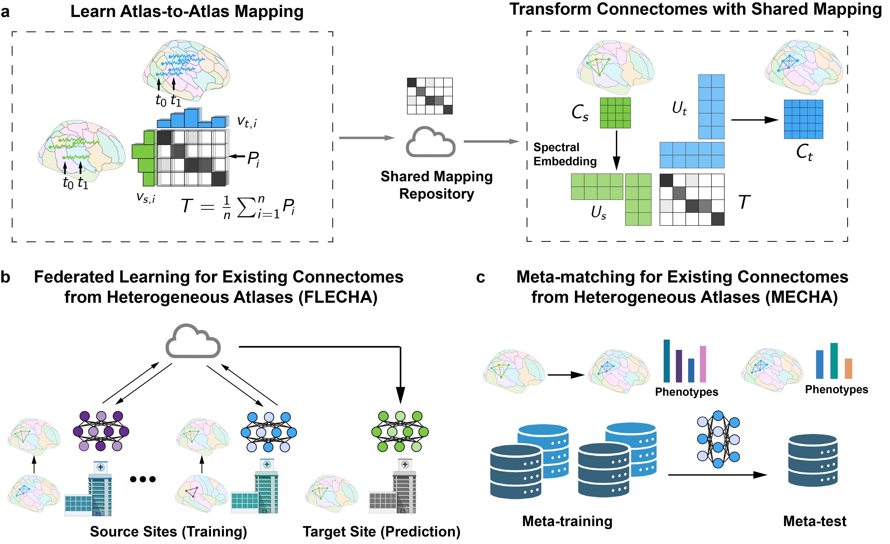

# Atlas-Interoperability Layer for Connectome Learning

This repository contains code for the manuscript:

**A Lightweight Atlas-Interoperability Layer for Connectome Learning**

The code implements an atlas-to-atlas transformation framework for processed brain connectomes and applies it to two downstream settings:

1. **FLECHA** — Federated Learning for Existing Connectomes from Heterogeneous Atlases  
2. **MECHA** — Meta-matching for Existing Connectomes from Heterogeneous Atlases  

---

## Overview

Connectomes generated using different brain atlases cannot usually be combined directly because the atlases define different brain regions. This repository provides a lightweight transformation layer that maps processed connectomes from a source atlas into a target-atlas space without reprocessing raw imaging data.

The transformed connectomes are then used for federated learning and sample-efficient phenotype prediction.

---

## Framework



**Figure 1. Framework for connectome transformation and downstream applications.**  
**a)** Atlas-to-atlas mappings are learned from node-wise fMRI time series in an independent reference dataset and reused to transform processed connectomes through spectral embedding and reconstruction.  
**b)** FLECHA transforms site-specific connectomes into a shared target-atlas space before federated model training.  
**c)** MECHA trains a DNN on transformed connectomes from a large meta-training cohort and uses the learned features for prediction in small target cohorts.

---

## Installation

Create a clean environment and install dependencies:

```bash
conda create -n atlas_interop python=3.10
conda activate atlas_interop
pip install -r requirements.txt
```

If needed, install the main dependencies manually:

```bash
pip install numpy scipy pandas scikit-learn matplotlib seaborn pyyaml tqdm joblib h5py nibabel pot torch
```

---

## Data Organization

The expected local data structure is:

```text
data/
├── raw/
│   ├── fc/
│   ├── sc/
│   └── timeseries/
├── mappings/
└── mapped/
    ├── fc/
    ├── sc/
    └── timeseries/
```

Suggested contents:

- `data/raw/timeseries/` — node-wise fMRI time series for learning atlas mappings.
- `data/raw/fc/` — native functional connectomes.
- `data/raw/sc/` — native structural connectomes.
- `data/mappings/` — learned source-to-target atlas mapping matrices.
- `data/mapped/fc/` — transformed functional connectomes.
- `data/mapped/sc/` — transformed structural connectomes.

Restricted individual-level data are not included. Users should populate these folders with authorized local data.

---

## How to Run the Code

The main scripts are located in:

```text
src/scripts/
```

Run the scripts from the repository root.

---

### 1. Learn atlas-to-atlas mappings

```bash
python src/scripts/run_fit_mapping.py
```

This learns source-to-target atlas mappings from node-wise fMRI time series.

Input:

```text
data/raw/timeseries/
```

Output:

```text
data/mappings/
```

---

### 2. Transform connectomes

```bash
python src/scripts/run_map_connectomes.py
```

This applies learned mappings to processed connectomes.

Inputs:

```text
data/raw/fc/
data/raw/sc/
data/mappings/
```

Outputs:

```text
data/mapped/fc/
data/mapped/sc/
```

---

### 3A. Run FLECHA

```bash
python src/scripts/run_FLECHA.py
```

This runs federated-learning experiments using transformed connectomes from heterogeneous atlas spaces.

Typical inputs:

```text
data/mapped/fc/
data/mapped/sc/
```

---

### 3B. Run MECHA DNN training

```bash
python src/scripts/run_MECHA_dnn.py
```

This trains the MECHA DNN on transformed connectomes from the meta-training cohort.

Typical inputs:

```text
data/mapped/fc/
data/mapped/sc/
```

---

### 4B. Run MECHA stacking / adaptation

```bash
python src/scripts/run_MECHA_stacking.py
```

This performs support-set adaptation and held-out phenotype prediction using DNN-derived features.

This step should be run after:

```text
run_MECHA_dnn.py
```

---

## Workflow Summary

For FLECHA:

```text
run_fit_mapping.py
    ↓
run_map_connectomes.py
    ↓
run_FLECHA.py
```

For MECHA:

```text
run_fit_mapping.py
    ↓
run_map_connectomes.py
    ↓
run_MECHA_dnn.py
    ↓
run_MECHA_stacking.py
```

---

## Script Summary

| Script | Purpose |
|---|---|
| `run_fit_mapping.py` | Learn source-to-target atlas mappings from reference time series. |
| `run_map_connectomes.py` | Transform processed connectomes into a target-atlas space. |
| `run_FLECHA.py` | Run federated-learning experiments across heterogeneous atlas spaces. |
| `run_MECHA_dnn.py` | Train the MECHA DNN on transformed meta-training connectomes. |
| `run_MECHA_stacking.py` | Run support-set adaptation and meta-test phenotype prediction. |

---

## Data Availability

This repository does not include restricted individual-level neuroimaging, behavioral, genetic, or health-related data.

The analyses use datasets such as UK Biobank, HCP-YA, HCP-D, and independent reference data. Access must be obtained through the official data access procedures of each dataset provider.
